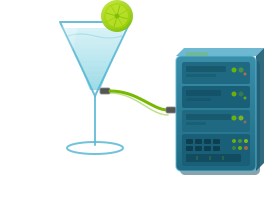

# DAQIRI - Data Acquisition for Integrated Real-time Instruments



**Send and receive Ethernet packets into CPU and GPU memory at hundreds of Gbps per GPU with a simple API.** 

DAQIRI (Data Acquisition for Integrated Real-time Instruments) connects data acquisition systems to NVIDIA GPUs for real-time processing and AI, paving the way for autonomy of the next generation of scientific and industrial instruments.


DAQIRI provides direct NIC hardware access in userspace, bypassing the Linux kernel network stack to achieve the highest possible throughput and lowest latency for Ethernet frame transmission and reception. It targets NVIDIA ConnectX-6 Dx and later NICs and supports GPU direct memory access (GPUDirect) for zero-copy data paths between the NIC and GPU.

<table>
<tr><td align="center">📖</td><td><strong>Docs &amp; Website:</strong> <a href="https://nvidia.github.io/daqiri/">nvidia.github.io/daqiri</a></td></tr>
<tr><td align="center">⚡</td><td><strong>Peak performance</strong> requires an NVIDIA SmartNIC (ConnectX-6 Dx or later) and a GPUDirect-capable NVIDIA GPU</td></tr>
<tr><td align="center">🖥️</td><td><strong>Supported hardware:</strong> NVIDIA DGX Spark, NVIDIA IGX, and NVIDIA RTX Pro Servers</td></tr>
<tr><td align="center">🔌</td><td><strong>Works with any NIC and NVIDIA GPU</strong> via DAQIRI's built-in Linux Sockets engine</td></tr>
<tr><td align="center">🚀</td><td><strong>Getting Started:</strong> <a href="https://nvidia.github.io/daqiri/getting-started/">nvidia.github.io/daqiri/getting-started</a></td></tr>
</table>

## Table of Contents

- [Features](#features)
- [Documentation](#documentation)
- [Tutorials](#tutorials)
- [Releases](#releases)
- [License](#license)

## Features

- **High-throughput, low-latency I/O** — Kernel-bypass raw Ethernet and GPUDirect transfers into CPU and GPU memory on compatible hardware.
- **Common C++ and Python APIs** — Build applications using raw Ethernet, RoCE/RDMA, or Linux UDP/TCP sockets.
- **Flexible packet handling** — Hardware flow steering, header-data split, and multi-region CPU/GPU buffers.
- **Packet reordering** — CPU and GPU reordering for downstream processing, with hardware-assisted placement on supported NICs.
- **Configuration-driven setup** — Define interfaces, queues, flows, and memory regions in YAML, with tools to generate and validate configurations.

## Documentation

The optional [Tegra MGBE userspace driver](drivers/mgbe/README.md) provides CPU
host-memory raw Ethernet with `engine: mgbe`, including kernel-shim build,
installation and rollback instructions.

Reference material for the DAQIRI codebase:

- [Getting Started](https://nvidia.github.io/daqiri/getting-started/) — System requirements, build/install instructions, and CMake options
- [Concepts](https://nvidia.github.io/daqiri/concepts/) — Glossary of DAQIRI terminology (kernel bypass, GPUDirect, packet/burst/segment, flow/queue, memory region, zero-copy ownership, RX reorder). Meant to be opened in parallel with the rest of the docs.
- [API Guide](https://nvidia.github.io/daqiri/api-reference/) — Six-step DAQIRI application lifecycle and configuration-first model
- [Configuration YAML Reference](https://nvidia.github.io/daqiri/api-reference/configuration/) — Full YAML config reference for all engines
- [Configuration Generation](https://nvidia.github.io/daqiri/config-generation/) — Deterministic production, benchmark, multi-queue, and cross-host configurations
- [C++ API Usage](https://nvidia.github.io/daqiri/api-reference/cpp/) — C++ RX/TX workflows, buffer lifecycle, file writing, utilities, and status codes
- [Python API Usage](https://nvidia.github.io/daqiri/api-reference/python/) — Python bindings, workflow examples, enums, config classes, and helper functions
- [Contributing](CONTRIBUTING.md) — Contribution guidelines, coding standards, DCO sign-off

> **Benchmarking and performance**
>
> Use the [Benchmarking overview](https://nvidia.github.io/daqiri/benchmarks/) to select a transport, configure benchmarks, and tune performance. See measured results for [DGX Spark](https://nvidia.github.io/daqiri/benchmarks/performance-dgx-spark/) and [IGX Thor](https://nvidia.github.io/daqiri/benchmarks/performance-igx-thor/).

### Agent-assisted onboarding

The [DAQIRI onboarding skill](skills/daqiri-onboarding/SKILL.md) helps you
set up DAQIRI, generate and validate configurations, and run your first benchmark.
Open your local DAQIRI repository in an agent that supports skills and ask:

```text
Use $daqiri-onboarding to help me generate and validate my first DAQIRI configuration.
```

## Tutorials

- [System Configuration](https://nvidia.github.io/daqiri/tutorials/system_configuration/) — Prepare the host, NIC, and GPU.
- [Understanding the Configuration File](https://nvidia.github.io/daqiri/tutorials/configuration-walkthrough/) — Walk through a DAQIRI YAML configuration.
- [Holoscan SDK Integration](https://nvidia.github.io/daqiri/tutorials/daqiri-holoscan-integration/) — Consume DAQIRI bursts in an HSDK application.
- [TensorRT Inference](https://nvidia.github.io/daqiri/tutorials/daqiri-resnet-inference/) — Build a packet-to-inference pipeline.

## Releases

DAQIRI ships formal releases quarterly using [calendar versioning](https://calver.org/). New features and fixes land on `main` continuously — pull and build from there for the latest.

## License

Apache 2.0 — see [LICENSE](LICENSE) for details.
