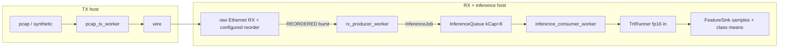

---
hide:
  - navigation
---

# DAQIRI → TensorRT ResNet Inference

This tutorial connects DAQIRI packet ingestion to a GPU inference pipeline.
Config-based GPU reorder converts wire **int8** samples into a contiguous
**fp16** NCHW batch, an SPSC ring decouples RX from TensorRT, and ResNet-50
emits one embedding vector per image — with no host bounce on the data path.
Source: `applications/resnet50_inference/`.

```
wire int8 packets (raw Ethernet, NIC-DMA into GPU-accessible buffers)
  → config-based GPU reorder + int8→fp16 (one burst = one inference batch)
  → SPSC handoff (RX producer | inference consumer)
  → ResNet-50 feature extraction (TensorRT, FP16 tensor cores)
  → FeatureSink (sample features + per-class mean-feature stats)
```

The pipeline needs **two hosts and one link**: one transmits, the other receives
and infers. The shipped configs and the `run_resnet_xhost.sh` helper default to a
pair of DGX Sparks cabled p0↔p0, but nothing in the application is
platform-specific — see [Run across two hosts](#run-across-two-hosts) for what a
different pair needs to change.

## Summary

| | |
|---|---|
| **Dataset** | CIFAR-10, 224×224, 3-channel color images |
| **Model** | ResNet-50 feature extractor via TensorRT (FP16 input binding + tensor cores) |
| **Output** | Tensor `features`, FP32, shape `[batch, 2048]` — one **2048-length embedding vector per image** |
| **Data path** | NIC DMA → RX buffers → reorder MR → TRT zero-copy read of reorder output → FeatureSink |

### Key parameter values

| Parameter | Value |
|-----------|-------|
| Image dimensions | 3 × 224 × 224 (CIFAR-10 upscaled) |
| Wire payload per packet | 1176 B int8 |
| Packets per image | 128 |
| Images per inference batch | 32 |

Images travel as signed int8 — one byte per pixel, `pixel − 128`, which is
lossless over 0..255 and costs no extra bytes. The reorder kernel reassembles
the packets and converts to fp16 in the same pass, so the network never carries
fp16 and the CPU never touches a pixel. One delivered burst is exactly one
`[32,3,224,224]` fp16 batch.

Two constraints are worth knowing before you change any of the four values
above:

- `packets_per_image` and `images_per_batch` must both be powers of two, and
  `--images-per-batch` must stay a power-of-two divisor of
  `packets_per_batch / packets_per_image`.
- For software reorder, `Data_RX_GPU`'s `buf_size` **must** equal
  `payload_byte_offset + out_payload_len` (64 + 1176 = 1240). DAQIRI derives
  the software reorder slot stride from the source buffer size.

The full parameter table is split between native `rx.reorder_configs` and the
app-level `packetization:` block; see `applications/resnet50_inference/README.md`
under **Config keys**.

## The pipeline

Two threads, two CUDA streams, and one ring between them. The NIC and the
reorder kernel fill batches on the reorder stream; TensorRT drains them on the
inference stream; the SPSC queue is the only thing the two app threads share.



## How it works

The walkthrough below follows one batch from the wire to an embedding vector
(`applications/resnet50_inference/main.cpp`, `inference_pipeline.cu`,
`spsc_queue.h`, `trt_runner.cu`).

### 1. Threads and CUDA streams

The RX side has a **reorder stream**, created by `main` and handed to the
engine; the inference side has its own stream owned by the consumer thread. Two
application threads sit on either side of the SPSC queue. Pin the engine,
producer, and consumer threads with `master_core`, `rx.queues[].cpu_core`,
`bench_rx.cpu_core`, and `inference.cpu_core` in the target host's config.

The consumer initializes TensorRT before the producer begins receiving. A cold
run may spend several minutes building the TensorRT engine, so start TX only
after RX reports `RX reorder ready` and `TrtRunner ready`. The RX worker exits
after a finite idle period if traffic never starts or stops unexpectedly.

### 2. Configure DAQIRI reorder

DAQIRI reorder is configured in the normal raw-Ethernet config under
`daqiri.cfg.interfaces[].rx.reorder_configs`. The shipped software path names
the output memory region, selects GPU reorder, declares int8-to-fp16 conversion,
and uses `seq_packets_per_batch` to derive each batch from the sequence field:

```yaml
rx:
  reorder_configs:
  - name: "rx_reorder_resnet_int8_fp16"
    reorder_engine: "sw"
    reorder_type: "gpu"
    memory_region: "Reorder_RX_GPU"
    payload_byte_offset: 64
    flow_ids: [201]
    data_types:
      input_type: "int8"
      output_type: "fp16"
      endianness: "host"
    method:
      seq_packets_per_batch:
        sequence_number:
          bit_offset: 128
          bit_width: 16
        packets_per_batch: 4096
```

The application's `packetization:` block now carries only image framing facts
that DAQIRI itself should not know:

```yaml
packetization:
  reorder_name: "rx_reorder_resnet_int8_fp16"
  packets_per_image: 128
  images_per_batch: 32
```

For software GPU reorder, `main` creates one CUDA stream and binds it to the
named DAQIRI reorder plan after `daqiri_init`:

```cpp
cudaStreamCreateWithFlags(&reorder_stream, cudaStreamNonBlocking);
if (daqiri::set_reorder_cuda_stream(cfg.rx.interface_name, cfg.reorder_name, reorder_stream) !=
    daqiri::Status::SUCCESS) {
  // fatal: reorder cannot run on a stream the app can observe
}
```

Hardware NIC reorder uses the same native `reorder_configs` location but sets
`reorder_engine: "hw"`, `cyclic_sequence: true`, and `packet_size`; it omits
`data_types` because the NIC direct-placement path cannot convert int8 to fp16.
That path pairs with an INT8 TensorRT input.

`seq_bit_width` must match the `--seq-bit-width` used to generate the pcap.
The application never launches a reorder kernel itself, never tracks a packet's
slot, and never accumulates an image — it consumes DAQIRI-delivered reordered
batches.

### 3. Receive a batch

In this example, burst size equals an inference batch, removing the need to
manage image reassembly across bursts.

DAQIRI delivers packets in bursts of DAQIRI-owned buffers, and the pointers in a
burst are valid only until the burst is freed (the
[zero-copy ownership](../concepts.md) rule):

```cpp
daqiri::BurstParams* burst = nullptr;
if (daqiri::get_rx_burst(&burst, port_id, queue_id) != daqiri::Status::SUCCESS ||
    burst == nullptr) {
  // no packets this poll — back off, count an idle poll, retry
}
```

A burst is only usable here if reorder actually ran on it. That is a flag check,
and a burst without it is freed on the spot:

```cpp
const uint32_t flags = burst->hdr.hdr.burst_flags;
if ((flags & daqiri::DAQIRI_BURST_FLAG_REORDERED) == 0U) {
  ++bursts_not_reordered;
  packets_not_reordered +=
      static_cast<uint64_t>(std::max<int64_t>(0, daqiri::get_num_packets(burst)));
  daqiri::free_all_packets_and_burst_rx(burst);
  continue;
}
```

A full batch carries `images_per_batch` images. A **timeout-flushed** batch does
not, and its true image count has to be queried — but the query can race the
reorder kernel that is still finishing:

```cpp
uint32_t n_img = cfg.images_per_batch;
if ((flags & daqiri::DAQIRI_BURST_FLAG_REORDER_TIMEOUT) != 0U) {
  daqiri::ReorderBurstInfo info{};
  // A timeout-flushed burst can still have its reorder event in flight, in
  // which case the info query reports NOT_READY: wait it out instead of
  // discarding a partially filled batch.
  constexpr uint32_t kInfoRetries = 2000;  // ~100 ms at 50 us per retry
  daqiri::Status info_status = daqiri::Status::NOT_READY;
  for (uint32_t attempt = 0; attempt < kInfoRetries; ++attempt) {
    info_status = daqiri::get_reorder_burst_info(burst, &info);
    if (info_status != daqiri::Status::NOT_READY) break;
    std::this_thread::sleep_for(std::chrono::microseconds(50));
  }
  n_img = info.source_packet_count / cfg.packets_per_image;
}
```

`NOT_READY` means the data is coming, not that it is bad, so the loop retries
rather than discards. This branch is live: the configs ship
`timeout_us: 2000`, so any batch that does not fill before a 2 ms idle gap
arrives here. A flush landing mid-image leaves stragglers that integer division
drops, counted as `remainder_dropped`.

Four things still drop a burst outright, and each has its own counter so
backpressure stays distinguishable from RX-side loss: a full SPSC queue
(`queue_full` — inference could not keep up), a partial batch holding fewer
packets than one image (`short_batch`), `get_reorder_burst_info` failing
(`info_failure`), and a null device pointer (`null_input`).

The reordered batch itself is a single pointer — the whole fp16 NCHW tensor,
contiguous, at packet 0 of the reorder output region:

```cpp
void* dev_input = daqiri::get_packet_ptr(burst, 0);
```

When the producer exits it prints every counter it kept, and these two lines are
the first thing to read after a run:

```text
rx_producer_worker: delivered_bursts=8 pushed_images=256 dropped_bursts=0 [queue_full=0 short_batch=0 info_failure=0 null_input=0]
rx_producer_worker: partial_bursts=0 partial_packets=0 early_flush_shortfall=0 remainder_dropped=0 info_failures=0 non_reordered_bursts=0 non_reordered_packets=0
```

`dropped_bursts` above zero means images were lost; the bracketed breakdown says
why. `partial_bursts` above zero means batches are closing on the idle timeout
instead of filling — usually a TX-rate symptom or misaligned queue sizes (see
[Run across two hosts](#run-across-two-hosts)). The producer also prints a
WARNING line for a full queue or dropped remainders, and a NOTE when more than
half the batches closed on timeout.

#### Where drops are counted

Loss is counted at two stages:

| Stage | Reported by | Counters |
|-------|-------------|----------|
| NIC | `daqiri::print_stats()` at shutdown | `imissed` (no RX descriptor), `ierrors`, `rx_nombuf`, plus mlx5 xstats |
| Reorder / producer | `rx_producer_worker` summary | `dropped_bursts` + its four reasons, `remainder_dropped`, `non_reordered_packets` |

One counter crosses stages. `queue_full` is reported by the producer but caused
by the consumer — it means inference could not keep up, not that the link lost
packets. Read it as backpressure; every other drop reason is genuine loss.

#### Type conversion

The reorder kernel does register-only int8→fp16 (load int8, convert, store
half). No fp32 buffer is materialized. ONNX prepends Mul/Add so
`y_c = x_fp16 * a_c + b_c` with `a_c = 1/(255*std_c)`,
`b_c = (128/255 - mean_c)/std_c` (R,G,B = channel 0,1,2). Shared constants live
in both `export_resnet_onnx.py` and `prepare_cifar10_pcap.py`. The `128/255`
term is the prep tool's pixel−128 offset being added back, so the round trip
through signed int8 is exact.

### 4. Pass the batch to the inference thread

The producer packages the batch as a descriptor and pushes it to the consumer,
so a slow TensorRT call never stalls the RX poll loop:

```cpp
struct InferenceJob {
  daqiri::BurstParams* burst = nullptr;  // reordered burst; free after TRT consumes it
  void* dev_input = nullptr;             // contiguous NCHW batch = get_packet_ptr(burst, 0)
  uint32_t batch_size = 0;               // images in this batch
  cudaEvent_t input_ready = nullptr;     // burst->event (reorder-kernel completion)
  std::chrono::steady_clock::time_point delivered_at{};  // host delivery timing
};
```

The queue is a fixed-capacity single-producer/single-consumer ring with no locks
or allocation. Dataset mode applies backpressure so every image is processed;
benchmark mode drops a burst when the queue is full so RX is not hidden behind
inference stalls. Select dataset mode with `dataset:` in YAML or `--dataset`.

### 5. Run inference and free the burst

The consumer pops a job, infers, and frees the *previous* burst:

```cpp
const bool ok =
    trt.infer(job.dev_input, job.batch_size, job.input_ready, release_evt, host_prev, n_prev);
if (ok) {
  if (host_prev != nullptr) sink.consume(host_prev, n_prev);
  if (prev_burst != nullptr) {
    daqiri::free_all_packets_and_burst_rx(prev_burst);
  }
  prev_burst = job.burst;
} else {
  daqiri::free_all_packets_and_burst_rx(job.burst);
}
```

Rotate `prev_burst` only on success; free the current burst on failure. Never
skip a free — a leaked burst drains the RX pool and produces
`NO_FREE_BURST_BUFFERS` / `NO_FREE_PACKET_BUFFERS` errors and NIC-level drops.

Deferring the free by one batch is safe because `infer` establishes this CUDA
event sequence:

```cpp
if (input_ready != nullptr) {
  cudaStreamWaitEvent(stream, input_ready, 0);  // reorder finished this batch
}
ctx->enqueueV3(stream);
cudaMemcpyAsync(host_buf_[buf], out_ptr, out_bytes, cudaMemcpyDeviceToHost, stream);
cudaEventRecord(release_evt, stream);           // input buffer becomes reusable
if (has_pending_[prev]) {
  cudaEventSynchronize(d2h_event_[prev]);        // previous output is host-visible
}
```

By the time `infer` returns successfully, that `cudaEventSynchronize` guarantees
the GPU has finished reading the previous batch's input and copying its output to
the host, so freeing that burst needs no blocking sync of our own. Features come
back **one batch late** for the same reason — double buffering by parity, so the
host never stalls the batch currently in flight.

### 6. Shut down

Because features arrive one batch late, the last batch is still in flight when
`drain_final` recovers that tail output, and the last retained burst is freed.
The producer joins before the consumer; the final summary and DAQIRI statistics
are emitted after both join; `daqiri::shutdown()` runs before the reorder stream
is destroyed. This order ensures every output is counted and every DAQIRI-owned
burst is returned.

## Build

TensorRT is required, so build in the `torch` base container:

```bash
BASE_IMAGE=torch BASE_TARGET=dpdk DAQIRI_ENGINE="dpdk ibverbs" scripts/build-container.sh

cmake -S . -B build-resnet -DCMAKE_BUILD_TYPE=Release -DBUILD_SHARED_LIBS=ON \
  -DDAQIRI_BUILD_PYTHON=OFF -DDAQIRI_ENGINE="dpdk ibverbs" -DDAQIRI_BUILD_APPLICATIONS=ON
cmake --build build-resnet -j --target daqiri_resnet50_inference
```

`build-resnet` is the directory `run_resnet_xhost.sh` expects. If you build
elsewhere, pass `--build-dir <dir>` to that script.

## Prepare model + dataset

```bash
python3 applications/resnet50_inference/tools/export_resnet_onnx.py \
  --model resnet50 --output models/resnet50_features.onnx --check

python3 applications/resnet50_inference/tools/prepare_cifar10_pcap.py \
  --num-images 256 --images-per-batch 32 --out data/cifar10_resnet.pcap
```

Engine cache path: `models/resnet50_features.fp16in.engine`. Re-export after
pulling exporter changes, then delete the cached engines so TensorRT rebuilds
with FLOAT32 `features` (the ONNX front-end stays FP16 input):

```bash
rm -f models/resnet50_features.fp16in.engine models/resnet50_features.fp16in.*.engine
```

## Run across two hosts

Start RX first, wait for `RX reorder ready` / `TrtRunner ready`, then
start TX with `ETH_DST_ADDR` set to the RX interface's MAC. The helper script
does both over SSH:

```bash
./applications/resnet50_inference/tools/run_resnet_xhost.sh --replay-once
```

Start TX promptly after RX is ready. The producer exits after a finite idle
period if no traffic arrives or if an active stream goes quiet.

Results land in `resnet-results/<run-id>.{summary,timeseries,rx.log,tx.log}`.

### Adapting to your hosts

The script and configs default to two DGX Sparks, but every platform-specific
value is overridable:

| What | Where | Default |
|------|-------|---------|
| Host names | `TX_HOST` / `RX_HOST` env | `spark-stacked-01` / `spark-stacked-02` |
| RX netdev (used to read the peer MAC) | `RX_IFACE` env | `det1` (`enp1s0f0np0` on most NICs) |
| Build directory | `--build-dir` | `build-resnet` |
| NIC PCIe address | `interfaces[].address` in both xhost configs | `0000:01:00.0` |
| CPU cores | `master_core`, `rx/tx.queues[].cpu_core`, `bench_{rx,tx}.cpu_core`, `inference.cpu_core` | shipped configs |

Network prep is Spark-specific: `scripts/setup_spark_xhost_net.sh` on both hosts
(see [system configuration](system_configuration.md)). On other platforms,
configure MTU and addressing for your NIC by hand.

### Queue sizing

Three settings must stay aligned with `packets_per_batch` (4096), or batches
straddle burst boundaries and flush partially:

- `rx.queues[].timeout_us: 2000` — finite, so a stalled batch resyncs at the
  batch boundary instead of being completed by the *next* batch's first packet.
- `rx.queues[].batch_size: 4096` — equal to `packets_per_batch` for latency
  measurements. Larger multiples are correctness-safe, but can make the
  indirect software path wait for a larger RX burst before delivering an
  already-complete reorder batch.
- `tx.queues[].batch_size` and `bench_tx.batch_size: 4096` — aligned to
  `packets_per_batch`, so a gap between TX bursts falls on a batch boundary.

Misalignment is quiet: the run completes but reports non-zero `partial_bursts` /
`dropped_bursts` and fewer images than sent. Rationale is in
`applications/resnet50_inference/README.md` under **Queue sizing vs. reorder
batches**.

### What a good run looks like

```text
pcap_tx_worker: tx_start unix_ns=<timestamp>
rx_producer_worker: batch_delivered index=0 unix_ns=<timestamp> images=32
pcap_tx_worker: sent <expected>/<expected> frames ... (send_failures=0 fill_failures=0 ...)
rx_producer_worker: delivered_bursts=<N> pushed_images=<expected> dropped_bursts=0 [queue_full=0 short_batch=0 info_failure=0 null_input=0]
inference latency (ms): mean=<...> p50=<...> p99=<...> (per batch of 32 images, n=<N>)
batch delivery->inference submit (us): first=<...> mean=<...> p50=<...> p99=<...> n=<N>
batch delivery->application-visible result (ms): first=<...> mean=<...> p50=<...> p99=<...> n=<N>
```

The `batch_delivered` timestamp is captured before the producer pushes the
complete reordered batch onto the inference queue. `tx_start` and
`batch_delivered` are host wall-clock timestamps, not NIC hardware timestamps;
subtract them across hosts only when the hosts' clocks are synchronized. The
application-visible result includes the runner's one-batch-delayed output
pipeline, while `inference latency` measures TensorRT execution with CUDA
events. Also expect a `kHALF` input binding, FLOAT32 (or converted) `features`,
the requested image count, and CIFAR-10 labels in the feature summary.

## Output

`FeatureSink` writes everything to **stderr**. It prints sample feature vectors
as they arrive, then a summary at shutdown with per-class means keyed by
**ground-truth** labels from the `.labels` sidecar.

```text
  feature[image 0, class 6 (frog)] = [<2048 embedding values>] (dim=2048)

=== ResNet inference summary ===
images=<expected> batches=<N> seconds=<...> => <...> img/s (wall)

Per-class mean-feature stats (first 8 dims + L2 norm of the mean vector):
  class  0   airplane (n=<...>): mean=[<first 8 values>, ...]  |mean|=<...>
```

## See also

- App README: `applications/resnet50_inference/README.md`
- Raw Ethernet reorder config: [configuration](../api-reference/configuration.md)
